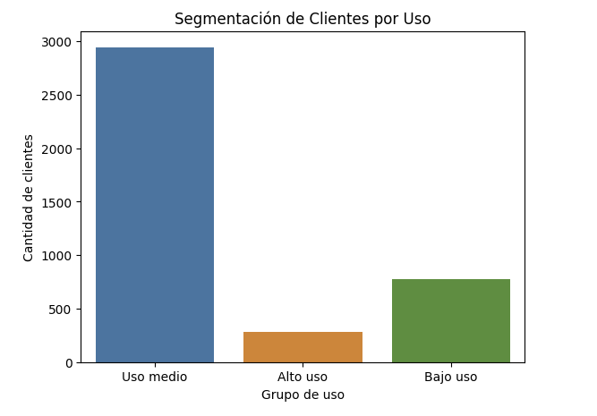

# ConnectaTel: Calidad de datos y segmentación de clientes

Caso de negocio simulado del bootcamp de Data Analytics de TripleTen. Los datos son ficticios.

## Pregunta de negocio
¿Cómo se comportan los clientes de una empresa de telecomunicaciones en Latinoamérica y cómo se pueden segmentar para mejorar sus planes?

## Datos
Tres datasets: planes (2), usuarios (4,000) y registros de uso (40,000), con información hasta 2024.

## Qué hice
1. Exploración de la estructura de los tres datasets.
2. Diagnóstico de calidad: nulos, sentinels (`-999` en edad y `?` en ciudad) y fechas fuera del periodo de análisis.
3. Limpieza: sentinels, fechas inválidas y registros sin fecha.
4. Análisis de nulos según el tipo de evento: los de `duration` y `length` dependen de si es llamada o mensaje, así que se conservaron.
5. Estadísticas de uso por cliente: mensajes, llamadas y minutos.
6. Distribuciones y outliers con el método IQR (se conservaron por ser patrones reales de uso intensivo).
7. Segmentación por nivel de uso y por edad.

## Hallazgos

*Clientes por nivel de uso.*

- La cartera se reparte entre los planes Básico (2,595 clientes, 64.9%) y Premium (1,405, 35.1%).
- Un cliente típico envía unos 5 mensajes y hace unas 4 llamadas, con cerca de 23 minutos de llamada.
- Predominan los adultos con uso medio. Los clientes de alto uso son pocos, pero son un segmento estratégico.
- No se observan diferencias de uso entre los planes Básico y Premium, ni entre grupos de edad.

## Limitaciones
- Los umbrales de los segmentos de uso los defino yo; otros umbrales cambiarían el tamaño de cada grupo.
- La comparación entre planes y edades es visual: no se aplicó una prueba estadística.
- El `-999` de la edad se reemplazó por la mediana, lo que puede suavizar la distribución.

## Recomendaciones
- Rediseñar el plan Premium para que ofrezca beneficios diferenciadores.
- Crear una oferta para usuarios de alto consumo.

## Herramientas
Python (pandas, NumPy, seaborn, Matplotlib)

## Contenido
- `connectatel-analysis.ipynb`: análisis completo.

## Nota
Los datos pertenecen al bootcamp y no se incluyen en este repositorio.
